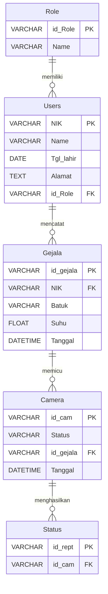

# Dokumentasi Rancangan Basis Data (ERD)

Dokumen ini berisi spesifikasi tabel, relasi antar-entitas, diagram Mermaid, dan skrip SQL DDL berdasarkan rancangan ERD terbaru.

---

## 1. Diagram ERD (Mermaid)



---

## 2. Spesifikasi Tabel

### A. Tabel `Role`
Menyimpan data peran/hak akses pengguna.

| Nama Kolom | Tipe Data | Keterangan | Key |
| :--- | :--- | :--- | :--- |
| `id_Role` | `VARCHAR(10)` | Identitas unik peran | **PK** |
| `Name` | `VARCHAR(50)` | Nama peran (misal: Admin, Pasien, Dokter) | - |

---

### B. Tabel `Users`
Menyimpan profil pengguna sistem.

| Nama Kolom | Tipe Data | Keterangan | Key |
| :--- | :--- | :--- | :--- |
| `NIK` | `VARCHAR(16)` | Nomor Induk Kependudukan | **PK** |
| `Name` | `VARCHAR(100)` | Nama lengkap pengguna | - |
| `Tgl_lahir` | `DATE` | Tanggal lahir pengguna | - |
| `Alamat` | `TEXT` | Alamat domisili pengguna | - |
| `id_Role` | `VARCHAR(10)` | Relasi ke peran pengguna | **FK** (`Role.id_Role`) |

---

### C. Tabel `Gejala`
Menyimpan riwayat pencatatan gejala pengguna.

| Nama Kolom | Tipe Data | Keterangan | Key |
| :--- | :--- | :--- | :--- |
| `id_gejala` | `VARCHAR(20)` | Identitas unik pencatatan gejala | **PK** |
| `NIK` | `VARCHAR(16)` | Pengguna yang memiliki gejala | **FK** (`Users.NIK`) |
| `Batuk` | `VARCHAR(20)` | Status/tingkat batuk | - |
| `Suhu` | `FLOAT` | Nilai suhu tubuh | - |
| `Tanggal` | `DATETIME` | Waktu pencatatan gejala | - |

---

### D. Tabel `Camera`
Menyimpan hasil tangkapan/pemrosesan kamera berdasarkan gejala.

| Nama Kolom | Tipe Data | Keterangan | Key |
| :--- | :--- | :--- | :--- |
| `id_cam` | `VARCHAR(20)` | Identitas unik rekaman kamera | **PK** |
| `Status` | `VARCHAR(50)` | Status deteksi kamera | - |
| `id_gejala` | `VARCHAR(20)` | Gejala yang memicu proses kamera | **FK** (`Gejala.id_gejala`) |
| `Tanggal` | `DATETIME` | Waktu perekaman kamera | - |

---

### E. Tabel `Status` *(atau Laporan)*
Menyimpan laporan/laporan akhir hasil analisis.

| Nama Kolom | Tipe Data | Keterangan | Key |
| :--- | :--- | :--- | :--- |
| `id_rept` | `VARCHAR(20)` | Identitas unik laporan | **PK** |
| `id_cam` | `VARCHAR(20)` | Rekaman kamera terkait | **FK** (`Camera.id_cam`) |

---

## 3. Skrip DDL SQL (MySQL)

```sql
-- 1. Tabel Role
CREATE TABLE Role (
    id_Role VARCHAR(10) PRIMARY KEY,
    Name VARCHAR(50) NOT NULL
);

-- 2. Tabel Users
CREATE TABLE Users (
    NIK VARCHAR(16) PRIMARY KEY,
    Name VARCHAR(100) NOT NULL,
    Tgl_lahir DATE NOT NULL,
    Alamat TEXT,
    id_Role VARCHAR(10) NOT NULL,
    CONSTRAINT fk_users_role FOREIGN KEY (id_Role) REFERENCES Role(id_Role) ON DELETE CASCADE ON UPDATE CASCADE
);

-- 3. Tabel Gejala
CREATE TABLE Gejala (
    id_gejala VARCHAR(20) PRIMARY KEY,
    NIK VARCHAR(16) NOT NULL,
    Batuk VARCHAR(20),
    Suhu FLOAT,
    Tanggal DATETIME DEFAULT CURRENT_TIMESTAMP,
    CONSTRAINT fk_gejala_users FOREIGN KEY (NIK) REFERENCES Users(NIK) ON DELETE CASCADE ON UPDATE CASCADE
);

-- 4. Tabel Camera
CREATE TABLE Camera (
    id_cam VARCHAR(20) PRIMARY KEY,
    Status VARCHAR(50),
    id_gejala VARCHAR(20) NOT NULL,
    Tanggal DATETIME DEFAULT CURRENT_TIMESTAMP,
    CONSTRAINT fk_camera_gejala FOREIGN KEY (id_gejala) REFERENCES Gejala(id_gejala) ON DELETE CASCADE ON UPDATE CASCADE
);

-- 5. Tabel Status / Report
CREATE TABLE Status (
    id_rept VARCHAR(20) PRIMARY KEY,
    id_cam VARCHAR(20) NOT NULL,
    CONSTRAINT fk_status_camera FOREIGN KEY (id_cam) REFERENCES Camera(id_cam) ON DELETE CASCADE ON UPDATE CASCADE
);
```